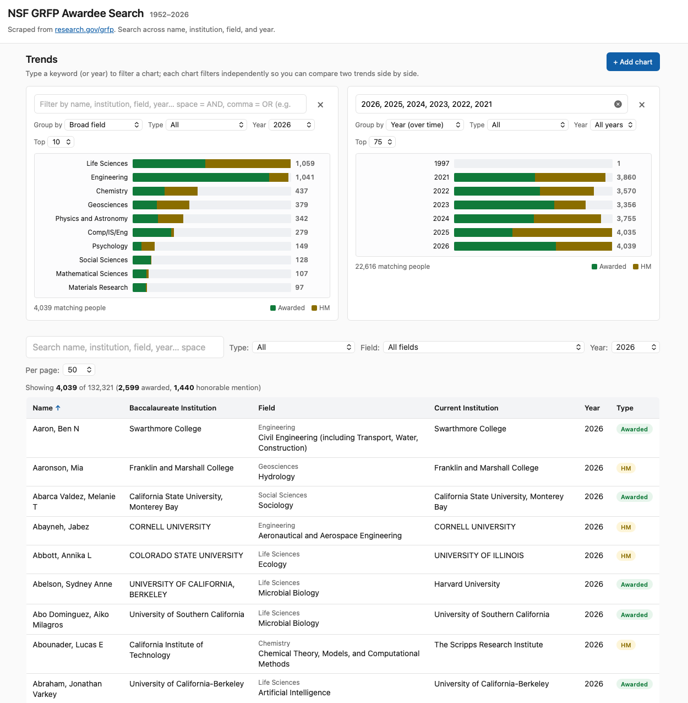

# NSF GRFP Awardee Search (1952–2026)

[](https://www.python.org/downloads/)
[](https://docs.astral.sh/uv/)
[](#disclaimer)
[](https://www.research.gov/grfp/AwardeeList.do?method=loadAwardeeList)

Every publicly listed NSF Graduate Research Fellowship Program awardee and honorable mention from 1952 through 2026, a DuckDB database over the full set, and a single-page website with keyword search, filters, and comparable trend charts.

Built by [Christan Grant](https://ceg.me).



Data snapshot date: 2026-04-16.
Source: <https://www.research.gov/grfp/AwardeeList.do?method=loadAwardeeList>.

| Metric | Value |
|--------|-------|
| Years covered | 1952–2026 (75 years) |
| Awarded fellows | 78,809 |
| Honorable mentions | 53,512 (HM data begins in 1994) |
| Total rows | 132,321 |

## Contents

| File | What it is |
|------|------------|
| `data/awards_YYYY.tsv` | Raw awarded recipients per year (75 files, UTF-8, tab-separated) |
| `data/honorable_mentions_YYYY.tsv` | Raw honorable mentions per year (33 files, 1994 onward) |
| `scrape_all_years.py` | UV script that walks every year on research.gov and fills `data/` |
| `build_db.py` | Loads every TSV in `data/` into DuckDB and emits `awardees.json` |
| `nsf_grfp.duckdb` | DuckDB database with a single `awardees` table across all years |
| `awardees.json` | String-interned JSON payload consumed by the web UI (~6 MB) |
| `index.html` | Single-page search + trends UI (no build step, no framework) |

## Data schema

The `awardees` table in `nsf_grfp.duckdb`:

| Column | Type | Notes |
|--------|------|-------|
| `name` | TEXT | `Last, First M` |
| `baccalaureate` | TEXT | Undergraduate institution |
| `field_broad` | TEXT | First half of the field label (e.g. `Engineering`, `Life Sciences`) |
| `field_specific` | TEXT | Second half (e.g. `Civil Engineering`); empty when the original label has no dash |
| `field_full` | TEXT | Original unsplit field label |
| `current_inst` | TEXT | Institution at time of application; often blank for pre-2000 records |
| `award_type` | TEXT | `Award` or `Honorable Mention` |
| `award_year` | INTEGER | 1952–2026 |

The field taxonomy is not consistent across decades. Expect variants like `Computer Science` vs `Computer and Information Science and Engineering` to appear as separate groups in the charts.

## Clone and install

```sh
gh repo clone cegme/nsfgrfp-search
# or
git clone https://github.com/cegme/nsfgrfp-search.git
cd nsfgrfp-search
uv sync
```

`uv sync` resolves `pyproject.toml` and installs `duckdb`, `loguru`, and `requests` into a local `.venv`. Python 3.10 or newer is required. The repo ships the raw TSVs, DuckDB database, JSON payload, and web UI, so the site works immediately with no build step — `uv sync` is only needed to re-run the scrape or rebuild the database.

## Run locally

### View the search site

```sh
uv run python -m http.server 8765
```

Open <http://127.0.0.1:8765>.

### Rebuild the DuckDB database and JSON payload

```sh
uv run python build_db.py
```

This regenerates `nsf_grfp.duckdb` and `awardees.json` from every TSV in `data/`.

### Query the database directly

```sh
uv run python -c "
import duckdb
con = duckdb.connect('nsf_grfp.duckdb', read_only=True)
rows = con.execute('''
    SELECT award_year, COUNT(*) AS n
    FROM awardees
    WHERE award_type = 'Award' AND current_inst ILIKE '%MIT%'
    GROUP BY award_year
    ORDER BY award_year
''').fetchall()
for r in rows:
    print(r)
"
```

Or open an interactive shell with `duckdb nsf_grfp.duckdb`.

## Re-scrape a fresh snapshot

```sh
uv run scrape_all_years.py
uv run python build_db.py
```

`scrape_all_years.py` only fetches years that are missing or have a near-empty file in `data/`, so re-runs are cheap and incremental. Add any new year automatically once research.gov exposes it in the dropdown.

## How the scrape works

The research.gov awardee list has an undocumented TSV export. Each year needs its own POST/GET sequence because the export URL reads the year and award type from the server-side session:

1. GET the awardee list page to seed `JSESSIONID`.
2. POST the search form with `awardYear=YYYY`, `awardType=A` (or `H`), `action=Search`.
3. GET the export endpoint, which replies with tab-separated data mislabeled as `application/vnd.ms-excel`.

The response is ISO-8859-1 even though the server labels it otherwise, so it needs to be transcoded before DuckDB will read it. Years with no honorable-mention data come back as an HTML error page, which `scrape_all_years.py` detects and skips.

The equivalent curl form for a single year:

```sh
curl -s -c cookies.txt "https://www.research.gov/grfp/AwardeeList.do?method=loadAwardeeList" -o /dev/null
curl -s -b cookies.txt -c cookies.txt -X POST "https://www.research.gov/grfp/AwardeeList.do" \
  --data "method=loadAwardeeList&awardYear=2026&awardType=A&action=Search" -o /dev/null
curl -s -b cookies.txt "https://www.research.gov/grfp/AwardeeList.do?method=sort&exportType=2" \
  | iconv -f ISO-8859-1 -t UTF-8 > data/awards_2026.tsv
```

## Site features

- Substring search across name, both institutions, field, and year. Spaces act as AND, commas act as OR (e.g. `MIT biology, Stanford chemistry` returns MIT-biology people plus Stanford-chemistry people).
- Filter by award type, broad field, and year.
- Sortable columns; click a header to toggle direction.
- Match highlighting on each keyword.
- Paginated at 50 rows per page.
- Trends panel above the results with stacked awarded / honorable-mention bars. Each chart has its own comma-OR filter, grouping dimension (broad field, specific field, baccalaureate, current institution, or **year over time**), type filter, year filter, and top-N. Add more charts to compare trends side by side.
- All filtering runs client-side over a ~6 MB string-interned JSON payload. No network after initial load.

## Repository

Private repo: <https://github.com/cegme/nsfgrfp-search>

## Disclaimer

This page is unaffiliated with NSF. The authoritative list lives at research.gov.
